# 🗓️ STRATEGI & KALENDER EDITORIAL: 30 KONTEN ARTIKEL SEO NOVEMBER 2026
## FOKUS UTAMA: SKINCARE & HAIRCARE DEDICATED SPRINT
**Brand**: Dreamlab Indonesia (PT Karya Impian Laboratoris)  
**Dokumen**: Kalender Produksi & Content Brief 30 Artikel  
**Fokus Kategori**: **Skincare (18 Artikel)** & **Haircare (12 Artikel)**  
**Fungsi**: Rencana aksi harian penulisan artikel SEO untuk merebut ranking Top 1–3 Google, mematahkan kompetitor (Mash Moshem, Nose Herbalindo, MPM Beauty), dan mengonversi lead ke sales WhatsApp (Annisa & Jessica).

---

## 1. Ringkasan Eksekutif & Struktur 4 Sprint Mingguan

Kalender produksi 30 konten November 2026 berfokus tajam pada dua lini produk dengan *market size* terbesar di Indonesia: **Skincare (Wajah & Sunscreen)** dan **Haircare (Kulit Kepala & Rambut)**.

```
[ SPRINT 1: Tgl 01 - 07 Nov ] ──► PONDASI BIAYA, MOQ, TERMIN & CARA MULAI (SKINCARE & HAIRCARE)
[ SPRINT 2: Tgl 08 - 14 Nov ] ──► FORMULASI INOVATIF & ACTIVE INGREDIENTS (SERUM, TONIC & SUNSCREEN)
[ SPRINT 3: Tgl 15 - 21 Nov ] ──► SCALP CARE REVOLUTION & REGIONAL PENETRATION (HAIR & SKIN FOCUS)
[ SPRINT 4: Tgl 22 - 30 Nov ] ──► KLINIK/SALON B2B, ADVANCED REPAIR & BRAND SCALING
```

---

## 2. Tabel Master 30 Artikel (November 2026: Skincare & Haircare)

| No | Tgl | Judul Artikel (H1) | Slug Target | Lini Produk Fokus | Intent (Mindmap) | Content Pillar | Funnel & Tier |
| :---: | :---: | :--- | :--- | :--- | :--- | :--- | :--- |
| **01** | 01 Nov | **Bongkar Biaya Maklon Skincare: Simulasi Modal Rp 20 Juta - Rp 100 Juta Siap Jual** | `/bongkar-biaya-maklon-skincare-lengkap` | **Skincare (Face Care)** | Transactional (Harga) | Jasa Maklon (Biaya & MOQ) | **BOF** / Tier 1-2 |
| **02** | 02 Nov | **Sistem Pembayaran Maklon Kosmetik: Skema Termin DP, Pelunasan & Tips Cash Flow Brand Baru** | `/sistem-pembayaran-termin-maklon-kosmetik` | **Skincare & Haircare** | Transactional (Harga/Cara) | Jasa Maklon (Biaya & MOQ) | **BOF** / Tier 1-2 |
| **03** | 03 Nov | **Simulasi Biaya Maklon Haircare Pemula: Modal Bikin Hair Tonic & Shampoo Merek Sendiri** | `/simulasi-biaya-maklon-haircare-pemula` | **Haircare (Rambut & Scalp)**| Transactional (Harga) | Jasa Maklon (Biaya & MOQ) | **BOF** / Tier 1-2 |
| **04** | 04 Nov | **Syarat Maklon Kosmetik untuk Pemula: Dokumen, Legalitas KTP vs PT & Step by Step** | `/syarat-maklon-kosmetik-pemula` | **Skincare & Haircare** | Transactional (Cara Mulai) | Regulasi (BPOM & Izin) | **BOF** / Tier 1 |
| **05** | 05 Nov | **7 Kesalahan Fatal Memilih Pabrik Maklon Kosmetik yang Bikin Brand Rugi Ratusan Juta** | `/kesalahan-fatal-memilih-pabrik-maklon` | **Skincare & Haircare** | Informational (Kesalahan) | Industri (Kompetitor/Risk) | **MOF** / Tier 1-2 |
| **06** | 06 Nov | **Katalog Formula vs Custom Formula Maklon: Mana yang Bikin Brand Bertahan Jangka Panjang?** | `/katalog-formula-vs-custom-formula` | **Skincare & Haircare** | Commercial (Rekomendasi) | Formula (Custom vs Katalog) | **MOF** / Tier 2-3 |
| **07** | 07 Nov | **Simulasi HPP Produk Kosmetik: Cara Menentukan Margin Keuntungan 300% Tanpa Takut Overprice** | `/simulasi-hpp-produk-kosmetik` | **Skincare & Haircare** | Transactional (Harga) | Brand Building (Positioning) | **BOF** / Tier 1-2 |
| **08** | 08 Nov | **Berapa Lama Proses Maklon Kosmetik dari R&D Sample Hingga Barang Jadi Siap Kirim?** | `/timeline-proses-maklon-kosmetik` | **Skincare & Haircare** | Transactional (Cara Mulai) | Jasa Maklon (Proses) | **BOF** / Tier 1-2 |
| **09** | 09 Nov | **Maklon Hair Tonic Anti-Rontok Biotin & Rosemary: Formulasi Scalp Care Tren 2026** | `/maklon-hair-tonic-anti-rontok-biotin-rosemary` | **Haircare (Rambut & Scalp)**| Commercial (Terbaik) | Formula (Bahan Aktif) | **BOF** / Tier 2 |
| **10** | 10 Nov | **Tren Active Ingredients Skincare 2026: Niacinamide Generasi Baru, Ectoin & Peptides** | `/tren-active-ingredients-skincare-2026` | **Skincare (Face Care)** | Informational (Tren Bahan) | Formula (Bahan Aktif) | **TOF** / Tier 2-3 |
| **11** | 11 Nov | **Maklon Hybrid Sunscreen: Solusi Anti White Cast & Formulasi Tahan Iklim Tropis Indonesia** | `/maklon-hybrid-sunscreen-anti-white-cast` | **Skincare (Sunscreen)** | Commercial (Terbaik) | Formula (Kategori Formula) | **MOF** / Tier 2 |
| **12** | 12 Nov | **Maklon Shampoo Bebas Sulfat (SLS/SLES-Free): Formulasi Lembut untuk Kulit Kepala Sensitif** | `/maklon-shampoo-bebas-sulfat-sls-free` | **Haircare (Rambut & Scalp)**| Commercial (Terpercaya) | Formula (Kategori Formula) | **MOF/BOF** / Tier 2 |
| **13** | 13 Nov | **Rekomendasi Pabrik Maklon Skincare Surabaya Berstandar CPKB Grade A & Halal Resmi** | `/rekomendasi-maklon-skincare-surabaya` | **Skincare (Face Care)** | Commercial (Rekomendasi) | Jasa Maklon (Lokasi/Grade) | **BOF** / Tier 2-3 |
| **14** | 14 Nov | **Maklon Serum Wajah Khusus Kulit Sensitif: Formulasi Hypoallergenic Tanpa Alkohol & Fragrance** | `/maklon-serum-kulit-sensitif` | **Skincare (Face Care)** | Commercial (Terpercaya) | Formula (Bahan Aktif) | **MOF** / Tier 2-3 |
| **15** | 15 Nov | **Maklon Scalp Scrub & Exfoliator: Solusi Ketombe Menumpuk & Eksfoliasi Kulit Kepala** | `/maklon-scalp-scrub-exfoliator` | **Haircare (Rambut & Scalp)**| Informational (Compare) | Formula (Kategori Formula) | **TOF/MOF** / Tier 2 |
| **16** | 16 Nov | **Jasa Maklon Kosmetik Bogor: Solusi Brand Owner Jabodetabek dengan Formula Eksklusif** | `/maklon-kosmetik-bogor` | **Skincare & Haircare** | Navigational (City) | Jasa Maklon (Maklon by City) | **BOF** / Tier 1-2 |
| **17** | 17 Nov | **Biotin vs Rosemary Oil vs Peptida: Mana Bahan Aktif Penumbuh Rambut Terbaik untuk Brand Anda?** | `/biotin-vs-rosemary-oil-penumbuh-rambut` | **Haircare (Rambut & Scalp)**| Informational (Compare) | Formula (Bahan Aktif) | **TOF/MOF** / Tier 2 |
| **18** | 18 Nov | **Beda CPKB Golongan A vs Golongan B: Mengapa Kualitas Pabrik Maklon Menentukan Keberhasilan Brand?** | `/beda-cpkb-golongan-a-vs-b` | **Skincare & Haircare** | Informational (Edukasi) | Regulasi (CPKB & GMP) | **MOF** / Tier 2-3 |
| **19** | 19 Nov | **Cara Mengurus Izin BPOM Kosmetik Lewat Maklon: Alur Notifikasi, Biaya & Masa Berlaku** | `/alur-izin-bpom-kosmetik-maklon` | **Skincare & Haircare** | Informational (Regulasi) | Regulasi (Regulasi BPOM) | **MOF/BOF** / Tier 1-2 |
| **20** | 20 Nov | **Maklon Hair Oil & Serum Rambut: Formulasi Ringan Tanpa Lepek dengan Argan & Peptida** | `/maklon-hair-oil-serum-rambut` | **Haircare (Rambut & Scalp)**| Commercial (Kategori) | Formula (Kategori Formula) | **BOF** / Tier 2 |
| **21** | 21 Nov | **Eksklusif 1 Client 1 Formula: Mengapa Dreamlab Menolak Formula Pasaran untuk Brand Klien** | `/keunggulan-1-client-1-formula-dreamlab` | **Skincare & Haircare** | Commercial (Terpercaya) | Formula (Custom Formula) | **BOF** / Tier 2-3 |
| **22** | 22 Nov | **Maklon Hair Mask Keratin Deep Repair: Formulasi Khusus Rambut Rusak Akibat Bleaching & Styling** | `/maklon-hair-mask-keratin-deep-repair` | **Haircare (Rambut & Scalp)**| Commercial (Kategori) | Jasa Maklon (Kategori Khusus) | **BOF** / Tier 2-3 |
| **23** | 23 Nov | **Pabrik Maklon Kosmetik Pekanbaru: Bangun Brand Skincare & Haircare Riau Tanpa Pabrik Sendiri** | `/maklon-kosmetik-pekanbaru` | **Skincare & Haircare** | Navigational (City) | Jasa Maklon (Maklon by City) | **BOF** / Tier 1-2 |
| **24** | 24 Nov | **Maklon Produk Rambut untuk Salon & Barbershop: Peluang Private Label Hair Styling & Treatment** | `/maklon-haircare-salon-barbershop` | **Haircare (B2B Salon)** | Transactional (Niche) | Jasa Maklon (Kategori Khusus) | **BOF** / Tier 2-3 |
| **25** | 25 Nov | **Maklon Hair Mist Wangi Mewah Tahan Lama: Peluang Bisnis Parfum Rambut Anti Bau Apek** | `/maklon-hair-mist-parfum-rambut` | **Haircare (Fragrance Hair)** | Commercial (Kategori) | Jasa Maklon (Kategori Khusus) | **MOF/BOF** / Tier 1-2 |
| **26** | 26 Nov | **Maklon Skincare untuk Dokter & Klinik Estetika: Formula Medis Eksklusif Standar Resep SpKK** | `/maklon-skincare-dokter-klinik-estetika` | **Skincare (Medis/Klinis)** | Transactional (Niche) | Jasa Maklon (Kategori Khusus) | **BOF** / Tier 3 |
| **27** | 27 Nov | **Tren Scalp-Care as Skin-Care 2026: Mengapa Brand Skincare Wajib Melirik Pasar Perawatan Rambut** | `/tren-scalp-care-skincare-rambut-2026` | **Skincare & Haircare** | Informational (Tren Beauty) | Industri (Peluang Pasar) | **TOF** / Tier 2 |
| **28** | 28 Nov | **Strategi Digital Marketing Skincare & Haircare Baru: Dari Pre-Launch, TikTok Ads hingga Repeat Order** | `/strategi-digital-marketing-skincare-baru` | **Skincare & Haircare** | Informational (Growth) | Marketing (Digital Marketing) | **TOF/MOF** / Tier 1-2 |
| **29** | 29 Nov | **Jasa Maklon Kosmetik Cirebon: Solusi Maklon Cepat & Legalitas Lengkap Wilayah Ciayumajakuning** | `/maklon-kosmetik-cirebon` | **Skincare & Haircare** | Navigational (City) | Jasa Maklon (Maklon by City) | **BOF** / Tier 1-2 |
| **30** | 30 Nov | **Cara Scaling Up Brand Kosmetik dari Omzet Puluhan Juta ke Miliaran Bersama Dreamlab** | `/cara-scaling-up-brand-kosmetik` | **Skincare & Haircare** | Informational (Scaling) | Marketing (Brand Growth) | **MOF/BOF** / Tier 2-3 |

---

## 3. Silo Linking Architecture: Skincare vs Haircare

Seluruh 30 artikel terhubung langsung ke dua silo landing page utama Dreamlab:

```mermaid
graph TD
    Home["Homepage dreamlab.id"] --> SiloSK["/produk/skincare/"]
    Home --> SiloHC["/produk/haircare/"]

    subgraph "SKINCARE CLUSTER (18 Artikel)"
        SK_Biaya["/bongkar-biaya-maklon-skincare-lengkap"]
        SK_Ingr["/tren-active-ingredients-skincare-2026"]
        SK_Sun["/maklon-hybrid-sunscreen-anti-white-cast"]
        SK_Surabaya["/rekomendasi-maklon-skincare-surabaya"]
        SK_Sensitif["/maklon-serum-kulit-sensitif"]
        SK_Dokter["/maklon-skincare-dokter-klinik-estetika"]
    end

    subgraph "HAIRCARE CLUSTER (12 Artikel)"
        HC_Biaya["/simulasi-biaya-maklon-haircare-pemula"]
        HC_Tonic["/maklon-hair-tonic-anti-rontok-biotin-rosemary"]
        HC_Shampoo["/maklon-shampoo-bebas-sulfat-sls-free"]
        HC_Scrub["/maklon-scalp-scrub-exfoliator"]
        HC_Compare["/biotin-vs-rosemary-oil-penumbuh-rambut"]
        HC_Oil["/maklon-hair-oil-serum-rambut"]
        HC_Mask["/maklon-hair-mask-keratin-deep-repair"]
        HC_Salon["/maklon-haircare-salon-barbershop"]
        HC_Mist["/maklon-hair-mist-parfum-rambut"]
        HC_Trend["/tren-scalp-care-skincare-rambut-2026"]
    end

    subgraph "SHARED FOUNDATION (Regulasi, Biaya, Termin & Regional)"
        Found_Termin["/sistem-pembayaran-termin-maklon-kosmetik"]
        Found_Syarat["/syarat-maklon-kosmetik-pemula"]
        Found_HPP["/simulasi-hpp-produk-kosmetik"]
        Found_CPKB["/beda-cpkb-golongan-a-vs-b"]
        Found_BPOM["/alur-izin-bpom-kosmetik-maklon"]
        Found_Custom["/keunggulan-1-client-1-formula-dreamlab"]
        Found_Bogor["/maklon-kosmetik-bogor"]
        Found_Pekanbaru["/maklon-kosmetik-pekanbaru"]
        Found_Cirebon["/maklon-kosmetik-cirebon"]
        Found_Scaling["/cara-scaling-up-brand-kosmetik"]
    end

    SK_Biaya --> SiloSK
    SK_Ingr --> SiloSK
    SK_Sun --> SiloSK
    SK_Surabaya --> SiloSK
    SK_Sensitif --> SiloSK
    SK_Dokter --> SiloSK

    HC_Biaya --> SiloHC
    HC_Tonic --> SiloHC
    HC_Shampoo --> SiloHC
    HC_Scrub --> SiloHC
    HC_Oil --> SiloHC
    HC_Mask --> SiloHC
    HC_Salon --> SiloHC
    HC_Mist --> SiloHC

    Found_Termin --> SiloSK
    Found_Termin --> SiloHC
    Found_Custom --> SiloSK
    Found_Custom --> SiloHC
    HC_Trend --> SiloSK
    HC_Trend --> SiloHC
```



---

## 4. Key Differentiation vs Kompetitor di Sektor Haircare

Pasar maklon haircare sering kali didominasi formula pasaran berkadar SLS tinggi dan sampo encer yang merusak rambut. Dreamlab menawarkan diferensiasi yang menjadi keunggulan utama pada artikel November:
1. **Sulfate-Free & Clean Formulation**: Bebas SLS/SLES, menggunakan surfaktan lembut berbasis kelapa (*Sodium Cocoyl Isethionate* / Glucoside) yang aman untuk kulit kepala sensitif dan psoriasis.
2. **Clinical Active Ingredients**: Mengintegrasikan Biotin murni, Rosemary Extract konsentrasi stabil, Panthenol, Keratin Complex, dan Peptida folikel.
3. **Scalp-Care as Skin-Care Philosophy**: Memperlakukan kulit kepala sama pentingnya dengan kulit wajah (ada eksfoliasi AHA/BHA, hidrasi ceramide, dan nutrisi barrier).
4. **Fleksibilitas MOQ untuk Salon & Barbershop**: Mendukung pemilik salon dan barbershop membuat *private label hair product* tanpa beban kuantitas berlebih.

---
*Dokumen kalender editorial ini telah disesuaikan khusus untuk fokus Skincare & Haircare November 2026.*
